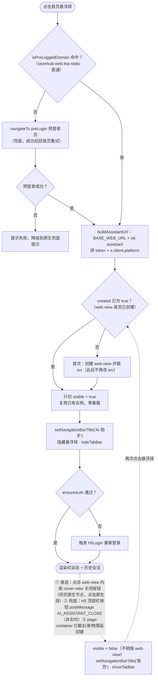
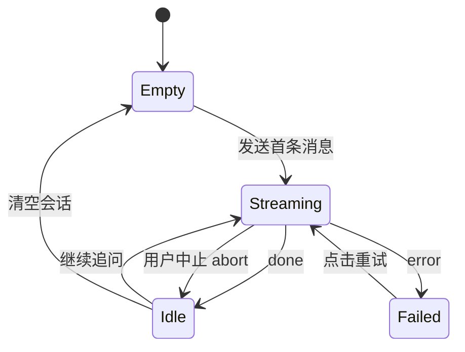
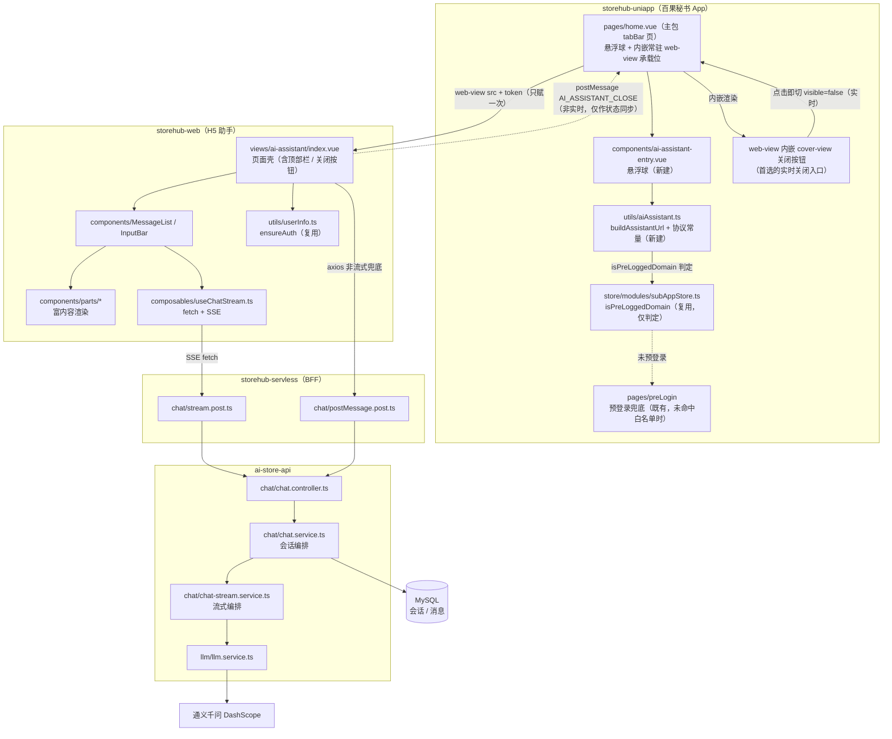
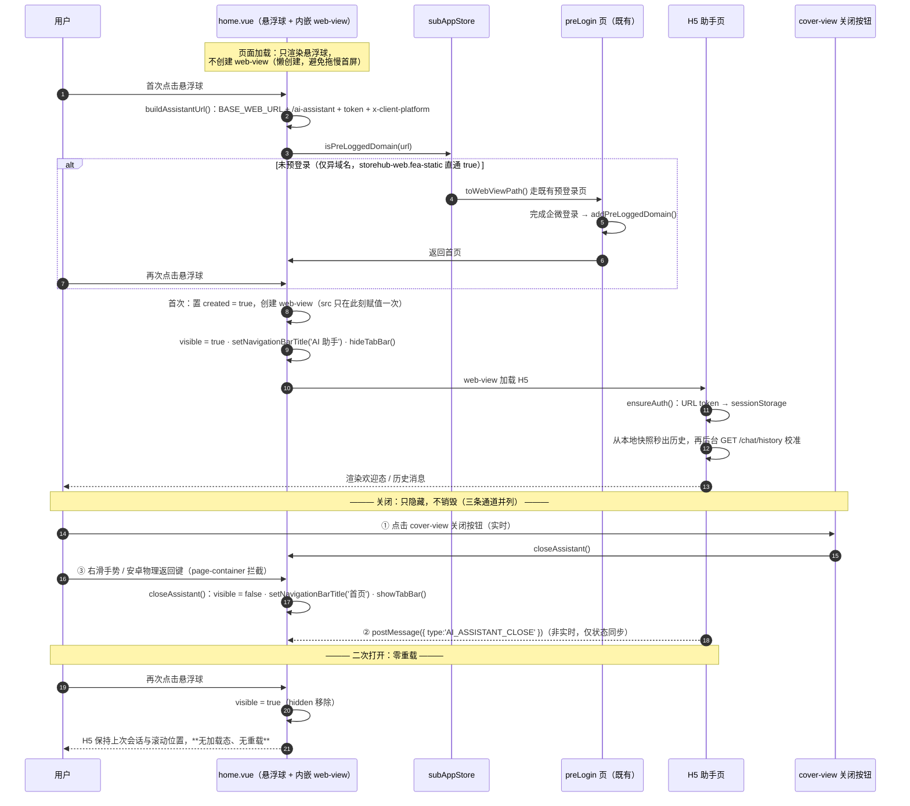
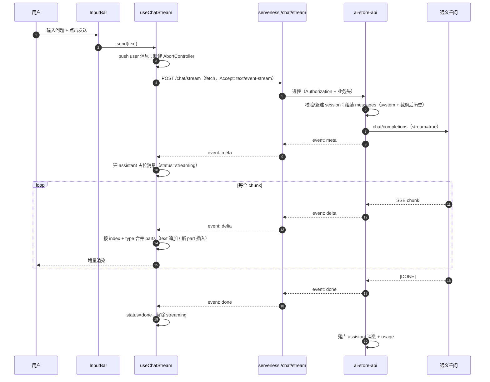
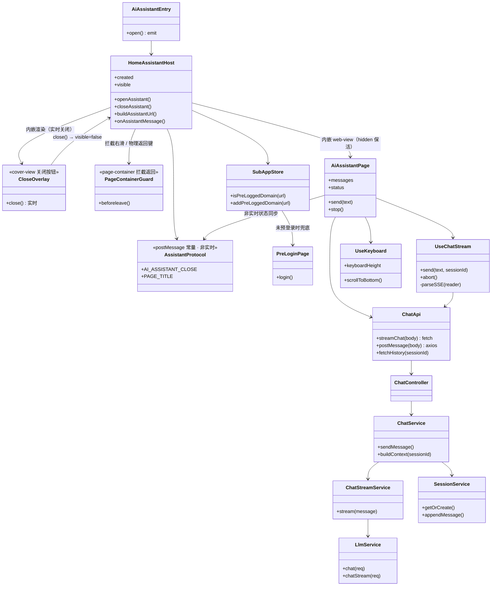

# 百果 AI 助手 模块设计

> 编写人：李宁           编写日期： 2026-09-20      项目：   百果秘书      版本号：v2.3.2
>
> **v2.3.0 变更**：原 MVP demo 所在分支已删除，新分支上 `storehub-uniapp` **无任何 AI 悬浮入口**、首页无历史包袱。本文档据此重构：小程序侧入口由「改造既有组件」改为「从 0 新建」，`ai-store-api` 侧仍为「在已有 chat 模块上扩展」。
>
> **v2.3.1 变更（容器选型 + 缓存保活）**：原设计（v2.3.0 的 Q5）主张「复用 `pages-workbench/subApp` 容器页跳转」。该链路**每次打开都是新建页面 → 新建 `web-view` → H5 整体重载**，体验不可接受。本期改为 **`home` 页面内嵌常驻 `web-view` + `hidden` 保活**：`web-view` 首次打开时创建，关闭仅隐藏不销毁，二次打开零重载。配套新增关闭协议与 H5 侧秒开（快照）要求，详见 4.5。**该决策只作用于 AI 助手入口，消息中心 / 工作台等既有 `subApp` 容器链路不动。**
>
> **v2.3.2 变更（关闭协议修正 · 入口链路技术实现细化）**：
> 1. **删除原「业务背景 / 价值点」章节**，文档重心转为**入口链路的技术实现**（本版不写产品叙事，只写已核实的技术事实、选型理由与落地细节）；
> 2. **修正一处设计缺陷**：v2.3.1 假设「H5 点关闭 → `postMessage` → 小程序立刻 `hidden`」**不成立**——`web-view` 的 `bind:message` **非实时**，仅在「小程序后退 / 组件销毁 / 分享 / 复制链接」等特定时机才触发（官方文档）。关闭入口改为**小程序侧 `web-view` 内嵌 `cover-view` 关闭按钮**（真机生效，点击直接切 `hidden`），H5 `postMessage` 降级为**非实时的状态同步**通道，详见 4.2.3；
> 3. **细化「首页悬浮球 → 唤醒 `web-view` → 打开聊天页」全链路**：新增悬浮球组件设计、懒创建状态机、关闭链路（`cover-view` + `page-container`）、`web-view` 原生导航栏约束等，详见 4.2。

---

### 一、现状基线与技术选型

> 本章只陈述**已核实的技术事实与选型理由**，不展开业务/需求叙事。

#### 1.1 现状基线（已逐文件核实）

原 MVP demo 所在分支已删除。新分支 `storehub-uniapp` 上**不存在** `components/ai-robot.vue`、`api/apis/chat.ts`、`api/service/chatService.ts`，`pages/home.vue` 模板只有 `<home-main />` + `<bulletin-popup />` 两行——**首页当前没有任何 AI 相关代码与挂载点**。因此小程序侧**不存在「改造」环节，悬浮球与 `web-view` 承载位都从 0 新建**。

| 现状资产 | 位置 | 状态 |
|---|---|---|
| 首页壳（**唯一承载位**） | `storehub-uniapp/src/pages/home.vue` | 存在，`tabBar` 页面、`navigationStyle: custom`、**主包**，模板仅 2 行，**无 AI 入口** |
| 首页主体（懒加载分包） | `storehub-uniapp/src/pages-home/home-main.vue` | 存在，`subPackage: true`，由 `pages.json` 的 `usingComponents` + `componentPlaceholder` 异步注入；**AI 相关代码不得放这里**（原因见 4.5.1） |
| 悬浮入口组件 | —— | **不存在，本期从 0 新建**（挂到 `pages/home.vue`） |
| AI 助手 `web-view` 承载位 | `storehub-uniapp/src/pages/home.vue` | **不存在，本期从 0 新建**（内嵌常驻 + `hidden` 保活，见 4.5） |
| 小程序侧对话 UI | —— | **不存在，且本期不做**（改由 H5 承载） |
| 跳转工具 | `storehub-uniapp/src/utils/webViewNavigate.ts` | 存在，`toWebViewPath()` 可直接调用（本期仅用于**预登录兜底**，不再用于主导航） |
| 预登录缓存 / 域名白名单 | `storehub-uniapp/src/store/modules/subAppStore.ts` | 存在，`isPreLoggedDomain(url)` 已导出，可单独用于判定；`storehub-web.fea-static` 直通 true |
| 既有 `web-view` 容器页 | `storehub-uniapp/src/pages-workbench/subApp/index.vue`、`src/pages-workbench/webView/index.vue` | 存在，token 注入已就绪；**本期助手入口不复用它们**（只复用其 token 注入写法） |
| 后端接口 | `ai-store-api/src/chat/chat.controller.ts` | 存在，`POST /chat/postMessage`，非流式 |
| 后端逻辑 | `ai-store-api/src/chat/chat.service.ts` | 存在，MVP 单轮，**无记忆** |
| 模型通道 | `ai-store-api/src/llm/llm.service.ts` | 存在，通义千问兼容模式，`https.request` **全量拼接** |
| BFF 代理层 | `storehub-servless/src/chat/` | **不存在，需新建** |

因此本期是**两段不同性质的活儿**：

| 侧 | 性质 | 说明 |
|---|---|---|
| `storehub-uniapp` | **从 0 到 1** | 新建一个轻量悬浮入口组件并挂到首页；不新建对话 UI、不新增接口调用 |
| `storehub-web` | **从 0 到 1** | 新建 `/ai-assistant` H5 助手页（对话 UI 全在这里） |
| `ai-store-api` | **在已有基础上扩展** | 复用现有 `chat` 模块与 `llm.service`，扩「流式 + 会话记忆 + 历史」 |
| `storehub-servless` | **从 0 到 1** | 新建 `src/chat/` 代理目录 |

#### 1.2 技术选型：为什么从「小程序原生弹窗」改为「webview + H5」

蓝图（`docs/ai-assistant-roadmap.md`）Phase 1 原文写的是「uniapp 首页悬浮组件」，即方案 A（弹窗内实现全部对话 UI）。经技术评估后本期改为**方案 B：uniapp 悬浮球 → 内嵌 `web-view` → H5 助手**（承载方式在 v2.3.1 定稿为「`home` 内嵌常驻 + `hidden` 保活」，见 4.5）。

| 维度 | 方案 A：小程序原生弹窗 | 方案 B：webview + H5 |
|---|---|---|
| 流式回复 | 需 `enableChunked` + `onChunkReceived` + `createTextDecoder` 降级链，且 Nginx 要关 `proxy_buffering`，坑多 | `fetch` + `ReadableStream` 约 30 行，标准 SSE 直接用 |
| Markdown/富文本 | 小程序无 DOM，需引入 `towxml`/`mp-html` 类方案自行适配 | 直接可用 |
| 卡片/表单/图表 | 小程序生态弱，图表需 canvas 自绘 | Vant + ECharts 现成生态 |
| 发版节奏 | 每次 UI 调整都要走小程序审核 | H5 独立发版，不走审核 |
| 渲染性能 | 流式高频 `setData` 跨线程通信，易卡死 | 同线程增量渲染 |
| 复用成本 | 需新建一整套小程序内对话 UI | 复用 H5 基建 + 既有 token 注入写法 |

**结论：选方案 B。** 唯一的代价是牺牲了一点「原生体验」，换取流式/富内容/迭代速度三个关键能力。

> ⚠️ **`web-view` 硬限制**（均出自微信官方 `web-view` 文档）：
> 1. **一个页面只能有一个 `web-view`**；
> 2. **可见时自动铺满整个小程序页面，并覆盖其他组件**——普通 `view` / `image` 一律盖不住它，`z-index` 无效；
> 3. **客户端 6.7.2 起 `navigationStyle: custom` 对 `web-view` 无效**——即 `web-view` 可见时必定带一段**原生导航栏**，去不掉。
>
> 由此推出两条不能做的做法：
> 1. ❌ 「弹窗里嵌 `web-view`」——`web-view` 不会乖乖待在弹窗里，会直接铺满整页；
> 2. ❌ 「普通 `view` 悬浮球浮在 `web-view` 之上」——可见的 `web-view` 会盖住悬浮球。
>
> 但**不**推出「不能用内嵌 `web-view`」，也不推出「关不掉」，因为有两个例外：
>
> - **`hidden` 时不占屏**：`web-view` 隐藏后不覆盖同级组件，此时悬浮球（普通 `view`）正常可见可点 → 可行形态是 **同页共存 + 显隐切换**（见 4.5），而非必须跳独立页面；
> - **`cover-view` 是唯一能覆盖 `web-view` 的组件**：作为 `web-view` 的**内嵌子节点**（`<web-view><cover-view>…</cover-view></web-view>`）或同级节点时，可覆盖在 `web-view` 之上并**接收点击**（`position: fixed; z-index: 99999`，**仅真机生效、开发者工具看不到**）。→ **关闭按钮用它实现**，详见 4.2.3。⚠️ 但 `cover-view` 只支持有限的子组件（`cover-view` / `cover-image`）与有限样式（**内联 `style` 不生效，须写在 WXSS**；安卓需补 `visibility: visible !important`），**不适合承载悬浮球这类复杂交互 UI**，故悬浮球仍用普通 `view`、在助手打开时隐藏。
>
> ⚠️ **证据冲突声明**：`cover-view` 覆盖 `web-view` 有大量实测可行的公开记录（博客园 / CSDN 等，含完整代码），但微信开发者社区也存在「`cover-view` 始终被 `web-view` 覆盖」的反例帖。**结论以真机为准**，因此关闭链路**不只有 `cover-view` 一条**（并行有 H5 顶部栏关闭按钮 + `hidden` 兜底），并登记为 **R9**（见 6.3）。

> 🔎 **对入口设计的直接影响**：由于 `web-view` 可见时自带原生导航栏，**助手页顶部会有一段不可去掉的原生栏**，H5 自己的顶部栏需要与之视觉衔接（见 4.8）；同时**标题不能用 H5 `document.title` 影响**，须由小程序侧 `uni.setNavigationBarTitle()` 在打开/关闭时切换。

#### 1.2.1 为什么不能「跳独立容器页 + 缓存」

`web-view` 是**页面级组件**：页面销毁 = `web-view` 实例销毁，且**小程序没有跨页面的 `web-view` 池**。由此：

| 做法 | 结果 |
|---|---|
| 每次点悬浮球 `navigateTo` 容器页 | 新页面 + 新 `web-view` + H5 整体重载，**体验最差**（原 v2.3.0 方案） |
| 容器页留在页面栈不返回 | 做不到——`switchTab` / `navigateBack` 都会销毁非 tabBar 页面；且容器页在栈顶会挡住首页 |
| **`web-view` 常驻首页（tabBar 页，切 tab 不销毁）+ 打开/关闭只切显隐** | ✅ **唯一能真正「不重载」的形态**，本期采用 |
| H5 侧做静态强缓存 + 会话快照「秒开」 | ✅ 正交增强，即使 `web-view` 重建了也几乎看不出重载，本期一并要求（见 4.5.3） |

#### 1.3 关键可行性结论（已逐条核实）

1. **预登录判定可独立调用**：`subAppStore` 已导出 `isPreLoggedDomain(url)`（`extractDomainRoot` 取根域 → `storehub-web.fea-static` 直通 `true` → 其它域查 2 天缓存）。悬浮球可**只判定不跳页**：命中则直接在内嵌 `web-view` 打开，未命中则用 `toWebViewPath()` 走既有 `preLogin` 页完成预登录。
2. **token 透传写法可照抄**：`pages-workbench/subApp/index.vue` 在 `src` 上拼 `token` 与 `x-client-platform`，**但那是容器页的逻辑**；内嵌方案要在 `home.vue` 内自行拼同样的参数（建议抽成 `buildAssistantUrl()` 复用）。H5 侧 `storehub-web/src/utils/userInfo.ts` 的 `ensureAuth()` 会从 URL 读 token 落到 `sessionStorage`。**（注意：只对 `storehub-web.fea-static` 域名注入 token，见 3.2 U1）**
3. **关闭通道可以打通，但不是「实时 RPC」**：`web-view` 的 `bind:message` **非实时**，仅在「小程序后退 / 组件销毁 / 分享 / 复制链接（2.31.1+）」等**特定时机**才把 H5 累积的 `postMessage` 以数组一次性抛给小程序（官方文档）。因此**不能用它做「点了就立刻关」**。本期关闭入口改为三条并行通道（详见 4.2.3）：
   - **首选**：小程序侧 `web-view` 内嵌 `cover-view` 关闭按钮 → 点击直接切 `hidden`（真机生效，无延迟）；
   - **并行**：H5 顶部栏关闭按钮 → `postMessage({type:'AI_ASSISTANT_CLOSE'})`，作为**非实时**兜底（依赖后退/销毁等时机触发）；
   - **兜底**：`page-container` 拦截右滑手势 / 安卓物理返回键 / `navigateBack`。
4. **标题控制改由小程序侧负责**：`web-view` 可见时自带原生导航栏且不吃 `navigationStyle: custom`，H5 的 `document.title` 也不会被采纳；因此打开助手时调 `uni.setNavigationBarTitle({ title: 'AI 助手' })`、关闭时还原为「首页」。`PAGE_TITLE` 的 `postMessage` 通道保留但**只作非实时同步**，不再是标题的唯一来源。
5. **后端底座已有**：`ai-store-api` 已有 `chat` 模块 + `llm.service`，本期只需在其上扩流式与会话记忆，**不引入 LangChain/向量库**。
6. **业务域名要求**：`web-view` 的 `src` 域名必须 **ICP 备案 + HTTPS + 企业主体**，且在微信小程序后台「业务域名」精确配置，否则真机白屏。**这是上线前的硬卡点，不是代码问题。**
7. **保活可行性（⚠️ 待真机确认）**：`hidden` 用于隐藏 `web-view` 且不销毁实例，是实现「二次打开零重载」的关键。该用法**不在微信官方 `web-view` 文档的明确承诺范围内**，多篇实践记录结论存在冲突（有称 `hidden` 有效、有称原生组件对 `hidden`/`display:none` 不生效）。因此：
   - `hidden` 生效 → 走 4.5.2 的常驻保活形态；
   - `hidden` 不生效 → 降级为 4.5.4 的兜底形态（`wx:if` 销毁重建 + H5 快照秒开），**必须在上线前完成真机验证**（列为 R7）。

---

### 二、需求内容概述（主要功能点）

#### 2.1 功能清单

| 编号 | 功能 | 说明 | 优先级 |
|---|---|---|---|
| F1 | 首页悬浮球入口 | **从 0 新建**轻量悬浮球组件（不新建对话 UI、不新增接口调用），挂到 `pages/home.vue` | P0 |
| F2 | 助手 `web-view` 承载与保活 | 在 `pages/home.vue` 内嵌常驻 `web-view`，首开创建 → 关闭只 `hidden` 隐藏 → 二次打开零重载；含预登录兜底 | P0 |
| F3 | 对话主界面 | 欢迎态 + 消息列表 + 底部输入区（发送/停止），H5 用 Vant 搭壳 | P0 |
| F4 | 流式回复 | SSE 打字机效果，支持中途「停止生成」（`AbortController`） | P0 |
| F5 | 多轮上下文 | `sessionId` 串联多轮，服务端按窗口裁剪后入模 | P0 |
| F6 | parts 富内容协议 | `text / card / actions / form / chart` 五类 part 的协议定义与渲染分发 | P1 |
| F7 | 历史会话持久化 | 会话与消息落库，重新进入可拉取最近会话 | P1 |
| F8 | 异常降级 | 超时/断网/未鉴权/流式中断 → 纯文本兜底 + 重试入口 | P0 |

#### 2.2 本期非目标（明确不做）

- ❌ RAG / 知识库 / 向量检索 / 文档上传
- ❌ 语音输入输出、图片多模态识别（`llm.service` 已有 vision 模型，但本期不接）
- ❌ AI 主动推送、待办提醒
- ❌ 与消息中心（`storehub-servless/src/message`）打通
- ❌ TabBar 级入口（本期只做首页悬浮球）
- ❌ 改动消息中心 / 工作台等既有 `subApp`、`webView` 容器链路（**只对助手入口生效**）
- ❌ 历史对话摘要压缩（留到接 RAG 时统一处理）

#### 2.3 涉及仓库与改动性质

| 仓库 | 改动性质 | 主要内容 |
|---|---|---|
| `storehub-uniapp` | **从 0 到 1** | 新建悬浮球组件挂到 `pages/home.vue`；在 `pages/home.vue` 内嵌常驻 `web-view` 承载助手 H5（`hidden` 保活）；`web-view` 内嵌 `cover-view` 关闭按钮；`AI_ASSISTANT_CLOSE` 保留为**非实时**状态同步协议。**不新建页面、不改 `pages.json`、不复用 `subApp` 容器** |
| `storehub-web` | 新增 | 新增 `/ai-assistant` 路由 + H5 助手页面 + parts 渲染组件 + 流式 composable |
| `storehub-servless` | 新增 | 新增 `src/chat/` 代理目录（`stream.post.ts` / `postMessage.post.ts`） |
| `ai-store-api` | 改造 + 新增 | 扩流式接口、会话记忆、历史接口；`llm.service` 增流式方法 |

---

### 三、需求疑问&逻辑梳理

#### 3.1 已澄清决策

| 编号 | 问题 | 结论 |
|---|---|---|
| Q1 | 载体：小程序原生 vs webview + H5 | **webview + H5**（理由见 1.2） |
| Q2 | 前端 UI 库 | **Vant**，沿用 `storehub-web` 现有组件体系；不引入 Ant Design X Vue / MateChat（PC 基因） |
| Q3 | 后端方案 | **100% 自研**，复用 `ai-store-api` + 自选模型；不接第三方 AI 助手 SaaS。助手本质是「LLM + 业务规则伪 AI」的组合 |
| Q4 | 入口位置 | **首页悬浮球**（从 0 新建组件，挂在主包 `pages/home.vue`），本期不做 TabBar 入口 |
| Q5 | 助手 `web-view` 承载方式 | **`pages/home.vue` 内嵌常驻 `web-view` + `hidden` 保活**（**不从 0 新建容器页、不复用 `subApp`**）。理由见 1.2.1 / 4.5；**仅对 AI 助手入口生效**，消息中心与工作台的 `subApp` 链路保持原样 |
| Q6 | 数据模型 | 参考 Vercel AI SDK 的 `message.parts` 数组模型（而非单 `content` 字符串） |
| Q7 | 事件协议 | 参考 AG-UI 事件流，自定义精简版 SSE 事件（`meta/delta/done/error`） |
| Q8 | 本期是否做流式 | **做**。流式是选 H5 的主要理由，不做则方案 B 收益大打折扣 |
| Q9 | **助手如何关闭**（H5 → 小程序） | **不能用 `postMessage` 做实时关闭**——`bind:message` 非实时（仅后退/销毁/分享/复制链接时触发）。改为**三条并行通道**：① `web-view` 内嵌 `cover-view` 关闭按钮（首选，点击即关）；② H5 顶部栏按钮 `postMessage`（非实时兜底）；③ `page-container` 拦截右滑/物理返回键。理由见 1.3 第 3 条 / 4.2.3 |

#### 3.2 待确认疑问

| 编号 | 疑问 | 影响 | 建议 |
|---|---|---|---|
| U1 | 助手 H5 是否与 `storehub-web.fea-static` 同域名？ | `subApp` 容器只对该域名注入 token，异域名会**拿不到 token** | 建议助手 H5 直接做在 `storehub-web` 内（同域，白名单天然命中）；若独立部署则改用 `webView` 容器（无条件注入） |
| U2 | 助手 H5 是否需要 `storehub-servless` 中转？ | 决定 SSE 是否穿两层代理 | 建议**保留中转**（统一域名/鉴权/脱敏），但必须在网关关闭 `proxy_buffering` 并对 `/chat/stream` 放行 `text/event-stream` |
| U3 | `sessionStorage` 里的 token 在 webview 内生命周期？ | 冷启动/切后台可能丢 token 导致需重新登录 | 需真机验证 `ensureAuth()` → `refreshToken()` 在 webview UA 下是否可用 |
| U4 | 会话与消息落库位置与保留期 | 影响 `ai-store-api` 是否需要新表 | 建议落 `ai-store-api` 自己的库，保留最近 90 天，不落 `storehub-servless` |
| U5 | 模型选型与成本上限 | 影响默认 `model` 与 `maxTokens` | 建议默认 `qwen3.6-flash`（快/便宜），复杂问题再走 `qwen3.7-plus`；本期不做自动路由 |
| U6 | 富内容 parts 首发支持几类？ | 决定 F6 工作量 | 建议首发只做 `text` + `card` + `actions`，`form` / `chart` 先定协议不实现 |

#### 3.3 逻辑梳理

**入口链路**



**关闭链路的三条通道（对应 Q9）**

| 通道 | 载体 | 实时性 | 触发方式 |
|---|---|---|---|
| ① 首选 | `web-view` **内嵌 `cover-view`** 关闭按钮（小程序侧原生节点） | **实时** | 用户点击 → 直接 `visible = false` |
| ② 兜底 | H5 顶部栏「关闭」按钮 → `postMessage({type:'AI_ASSISTANT_CLOSE'})` | **非实时** | 仅在「小程序后退 / 组件销毁 / 分享 / 复制链接」时机被 `bind:message` 批量投递 |
| ③ 手势/按键 | `page-container` 拦截 | 实时 | 右滑手势 / 安卓物理返回键 / `navigateBack`（**PC 端 `navigateBack` 不生效**，需 `window.history.back()` 兜底） |

> ⚠️ 三条通道**都只切 `visible`**，语义统一为「隐藏不销毁」；任一通道触发都不得重建 `web-view`。

**五条关键约束**

1. **一个页面一个 `web-view`，且可见时全屏覆盖** → 悬浮球与助手**同页共存、靠显隐切换**：助手可见时隐藏悬浮球（普通组件盖不住 `web-view`），仅 `cover-view` 能覆盖并接收点击（见 1.2 的硬限制说明）。
2. **`bind:message` 非实时** → 不能用 `postMessage` 做「点关闭 → 立刻隐藏」的控制信号，只能做状态同步；主关闭入口必须是**小程序侧原生节点（`cover-view`）**。
3. **流式不能走现有 axios 封装**：`storehub-web/src/api/http.ts` 有 `timeout: 30000` 且响应拦截按 `code` 解析 JSON，会直接破坏 SSE。流式必须走独立 `fetch` 通道，只复用 token / 岗位头取值函数。
4. **H5 视口声明必须完整**：`storehub-web/src/App.vue` 的 `setViewport()` 是**整体覆写** `content`（不是只改 width），助手页若自建页面需带上全部约束（`user-scalable=no` / `maximum-scale` / `viewport-fit=cover` / `interactive-widget=resizes-visual`），漏写会把禁缩放一起抹掉。
5. **富内容必须有纯文本 fallback**：每个 part 都要带 `fallback` 文本，用于①入模前纯文本化 ②渲染失败降级 ③复制/转发。

**对话状态机**



---

### 四、模块设计

#### 4.1 整体架构



#### 4.2 入口链路：首页悬浮球 → 唤醒 web-view → 打开助手

本节细化整条入口链路，拆为四小节：**4.2.1 悬浮球** → **4.2.2 唤醒与承载** → **4.2.3 关闭链路** → **4.2.4 完整时序**。

##### 4.2.1 悬浮球（`components/ai-assistant-entry.vue`，新建）

**职责边界**：只负责「显示 + 派发打开事件」。**不持有任何业务逻辑**——不拼 URL、不判定白名单、不碰 `web-view`。这些全部下沉到 4.2.2 的 `home.vue`。

**展示规则**

| 项 | 取值 | 理由 |
|---|---|---|
| 定位 | `position: fixed; right: 40rpx; bottom: 200rpx` | 避开 TabBar 与手机底部安全区（`env(safe-area-inset-bottom)`） |
| 显隐 | `v-if="!visible"`（助手可见时整体移除） | 助手可见时 `web-view` 全屏覆盖，悬浮球留着也点不到，直接移除更干净 |
| 组件类型 | 普通 `view`（**不是 `cover-view`**） | `cover-view` 样式能力受限（子节点只能是 `cover-view`/`cover-image`、内联 `style` 不生效），做不了悬浮球的图标 + 文案 + 动效 |
| 层级 | 常规 `z-index` 即可 | 与 `web-view` **不同时可见**，不存在层级竞争 |
| 点击节流 | `openAssistant()` 内加 `opening` 互斥标记 | 防连点导致重复置位 / 重复创建 |

**交互细节**

- 首屏**不预加载** H5，悬浮球本身零网络请求；
- 悬浮球在 `home`（tabBar 页）内，**切 tab 不销毁**，返回首页时状态自然保持；
- 点击后**立即**置 `visible = true`（不等 H5 加载完），H5 的加载态由 `web-view` 自身承担——避免「点了没反应」。

```vue
<!-- components/ai-assistant-entry.vue（示意，非最终代码） -->
<template>
  <view class="ai-ball" @click="emit('open')">
    <image class="ai-ball__icon" src="/static/ai-assistant.png" mode="aspectFit" />
    <text class="ai-ball__label">AI 助手</text>
  </view>
</template>

<script setup lang="ts">
const emit = defineEmits<{ (e: 'open'): void }>();
</script>

<style lang="scss" scoped>
.ai-ball {
  position: fixed;
  right: 40rpx;
  bottom: calc(200rpx + env(safe-area-inset-bottom));
  z-index: 100;
}
</style>
```

##### 4.2.2 唤醒与承载（懒创建状态机）

`home.vue` 只多两个状态：

| 状态 | 含义 | 变更时机 |
|---|---|---|
| `created` | `web-view` 是否已创建。**首次点击才置 `true`** | 单向：`false → true`，除 R7 降级外不回落 |
| `visible` | 是否显示。`true` = 铺满全屏即助手；`false` = 加 `hidden`，实例与 H5 页面状态全部保留但不可见 | 每次打开 / 关闭切换 |

**打开流程（`openAssistant()`）**

1. **预登录判定**：`buildAssistantUrl()` 拼出完整 URL → `isPreLoggedDomain(url)` 判定（`storehub-web.fea-static` 直通 `true`）；
2. **未命中**：走 `toWebViewPath()` 进既有 `preLogin` 页完成企微预登录，返回首页后用户重试（**本期唯一保留的跳页分支**）；
3. **命中**：`created = true` → 首次创建 `web-view` 并赋 `src`（**此后永不改 `src`**）；
4. `visible = true` → `uni.setNavigationBarTitle({ title: 'AI 助手' })` → `uni.hideTabBar()`。

**URL 拼装（`utils/aiAssistant.ts#buildAssistantUrl()`）**

```ts
// 与 pages-workbench/subApp/index.vue 的 token 注入写法一致，但只在 home.vue 内自用
export const AI_ASSISTANT_PATH = 'ai-assistant';

export function buildAssistantUrl(): string {
  const base = BASE_WEB_URL.replace(/\/+$/, '');
  const url = `${base}/${AI_ASSISTANT_PATH}`;
  // 只有 fea-static 域名才注入 token（其它域名由 preLogin 兜底处理）
  if (!url.includes('storehub-web.fea-static')) return url;
  const token = uni.getStorageSync(BGMS_TOKEN);
  return `${url}?token=${encodeURIComponent(token)}&${HEADER_PLATFORM}=${getClientPlatform()}`;
}
```

```vue
<!-- pages/home.vue（示意，非最终代码） -->
<template>
  <home-main v-if="isShow" />
  <bulletin-popup :visible="showPopup" :message-data="popupData" @close="showPopup = false" />

  <!-- 悬浮球：仅在助手未打开时渲染 -->
  <ai-assistant-entry v-if="!visible" @open="openAssistant" />

  <!-- 助手承载位：created 后常驻；只切 hidden，永不改 src -->
  <web-view
    v-if="created"
    :hidden="!visible"
    :src="assistantUrl"
    @message="onAssistantMessage"
    @error="onAssistantError"
  >
    <!-- 关闭按钮：唯一能盖住 web-view 的组件（样式必须写在 WXSS，不能用内联 style） -->
    <cover-view class="ai-close" @click="closeAssistant">关闭</cover-view>
  </web-view>
</template>
```

**三条硬约束**

1. **`src` 只在创建那一次赋值，之后永不修改**——改 `src` = 整页重载，保活前功尽弃；
2. **不要用 `v-if` 控制 `web-view` 显隐**（`v-if` = 销毁重建 = 每次重载），只切 `hidden`；
3. `onShow` / `onHide` / 身份切换等钩子里**不要重建 `web-view`**。

> 🔗 承载位**必须在主包 `pages/home.vue`**，不能进分包 `home-main`——完整论证见 4.5.1。

##### 4.2.3 关闭链路（三条通道）

**问题**：`web-view` 可见时全屏覆盖，**普通组件（含悬浮球）一律点不到**；而官方文档明确 `bind:message` **非实时**（仅在小程序后退 / 组件销毁 / 分享 / 复制链接时批量投递），因此**不能**把「H5 点关闭 → 小程序立刻隐藏」当作控制信号。

**方案**：三条通道并行，**语义统一为「只切 `visible = false`，绝不销毁 `web-view`」**。

| # | 通道 | 实现 | 实时性 | 备注 |
|---|---|---|---|---|
| ① | **首选**：`cover-view` 关闭按钮 | 写在 `<web-view>` 内作为子节点，`@click` → `closeAssistant()` | **实时** | 唯一能覆盖 `web-view` 的组件；**仅真机生效**，开发者工具看不到 |
| ② | 兜底：H5 顶部栏关闭 | H5 调 `miniProgramPostMessage({ type: 'AI_ASSISTANT_CLOSE' })` → `home.vue` 的 `@message` 接住 | **非实时** | 依赖后退 / 销毁等时机投递；用于「用户没点 `cover-view` 但已离开助手」的场景 |
| ③ | 手势 / 按键 | `<page-container :show="visible" @beforeleave="closeAssistant" />` | 实时 | 拦截右滑手势、安卓物理返回键、`navigateBack` |

**`cover-view` 的落地要点（踩坑清单）**

```scss
/* 必须写在 WXSS：内联 style 对 cover-view 不生效 */
.ai-close {
  position: fixed;
  top: 24rpx;
  left: 24rpx;
  z-index: 99999;
  padding: 12rpx 28rpx;
  color: #fff;
  font-size: 28rpx;
  background: rgba(0, 0, 0, 0.45);
  border-radius: 999rpx;
}
```

1. **位置**：`cover-view` 必须直接作为 `web-view` 的**子节点或同级兄弟节点**，**不要**先包一层普通 `view` 再包 `web-view`；
2. **样式**：只能写在 **WXSS**（内联 `style` 不生效），子节点只能用 `cover-view` / `cover-image`；
3. **安卓补丁**：`cover-view, cover-image { visibility: visible !important; z-index: 99999; }`；
4. **显隐用 `v-show` 不用 `v-if`**（安卓上用 `v-if` 控制 `cover-view` 会出问题）；
5. **绝对位置的最终值需真机校准**——`web-view` 可见时自带原生导航栏（`navigationStyle: custom` 对它无效），关闭按钮不能与导航栏重叠（⚠️ 记入 R9 一并真机验证）；
6. **兜底思路**：若真机上 `cover-view` 仍被覆盖（社区存在反例），关闭改由 ② + ③ 承担，并在 H5 内提供显著的返回入口——**协议不变，只改关闭按钮的载体**。

**PC 端提醒**：`wx.miniProgram.navigateBack` 在 PC 端微信**不生效**（返回 `undefined`），H5 侧需用 `window.history.back()` 兜底，最终仍以 ② 的 `postMessage` 或 ③ 的 `page-container` 收口。

##### 4.2.4 完整时序



> ⚠️ **关闭入口的实时性是本节的关键约束**：`web-view` 可见时铺满全屏并盖住普通组件，因此关闭入口**首选 `web-view` 内嵌的 `cover-view` 按钮**（同页原生节点，点击即生效）；H5 顶部栏的「关闭」按钮保留为**非实时兜底**（`bind:message` 仅在后退/销毁/分享/复制链接时投递）。详见 4.2.3。
>
> 💡 打开期间用 `uni.hideTabBar()`、关闭时 `uni.showTabBar()`，避免助手与首页 tabBar 视觉打架（`home` 是 tabBar 页）。

#### 4.3 流式对话时序



#### 4.4 三端模块结构

**storehub-uniapp（从 0 到 1，只动主包首页）**

```
src/
├── components/
│   ├── ai-assistant-entry.vue    # 【新建】轻量悬浮球：纯展示 + emit open，无对话 UI / 无接口调用
│   └── ai-assistant-close.vue    # 【新建】cover-view 关闭按钮（须与 web-view 同级/子级，样式走 WXSS）
├── pages/
│   └── home.vue                  # 【改造·唯一改动点】悬浮球 + 内嵌常驻 <web-view> + page-container
├── utils/
│   └── aiAssistant.ts            # 【新建】buildAssistantUrl() + 打开/关闭协议常量
└── store/modules/
    └── subAppStore.ts            # 【复用】isPreLoggedDomain（只判定，不跳页）

不改：
├── pages-workbench/subApp/index.vue    # 助手入口不经过它（仅参考 token 注入写法）
├── pages-workbench/webView/index.vue   # 同上
├── pages-home/home-main.vue            # 分包懒加载组件，不碰（原因见 4.5.1）
└── config/pages.ts + config/modules/*  # 无新页面，pages.json 无需变更

不存在（v2.3.0 的「改造 / 删除」条目全部作废）：
└── components/ai-robot.vue、api/apis/chat.ts、api/service/chatService.ts
```

新增 / 改动清单：

| 文件 | 动作 | 说明 |
|---|---|---|
| `src/components/ai-assistant-entry.vue` | **新建** | 悬浮球，`position: fixed; right: 40rpx; bottom: 200rpx`（避开 TabBar 安全区）；只 emit `open`，不持有任何业务逻辑（见 4.2.1） |
| `src/components/ai-assistant-close.vue` | **新建** | `cover-view` 关闭按钮，作为 `web-view` 的**子节点**渲染；样式必须写在 WXSS、安卓补 `visibility: visible !important`（见 4.2.3） |
| `src/pages/home.vue` | **改造** | 引入悬浮球；新增 `created` / `visible` 状态与 `<web-view :hidden="!visible">`；挂 `<page-container>` 拦截返回；`@message` 仅作**非实时**状态同步 |
| `src/utils/aiAssistant.ts` | **新建** | `buildAssistantUrl()` 拼 `token` + `x-client-platform`；`AI_ASSISTANT_PATH = 'ai-assistant'`；`postMessage` 类型常量 |
| `config/pages.ts`、`config/modules/*` | **不动** | 无新页面，`pages.json` 无需变更 |
| `src/pages-workbench/subApp/index.vue` | **不动** | 仅作为 token 注入写法的参考 |

**storehub-web（新增）**

```
src/
├── views/ai-assistant/
│   ├── index.vue                 # 页面壳：顶部栏 + 三段布局 + 视口/键盘适配
│   ├── components/
│   │   ├── TopBar.vue            # 顶部栏：标题 + 「关闭」按钮（非实时兜底，见 4.2.3）
│   │   ├── MessageList.vue       # 虚拟滚动 + 自动滚底
│   │   ├── MessageItem.vue       # 按 part.type 分发渲染
│   │   ├── InputBar.vue          # 输入框 + 发送/停止
│   │   ├── WelcomeGuide.vue      # 空态引导（推荐问题）
│   │   └── parts/
│   │       ├── TextPart.vue      # Markdown 渲染
│   │       ├── CardPart.vue
│   │       ├── ActionsPart.vue
│   │       ├── FormPart.vue      # 【协议先定，本期可后置】
│   │       └── ChartPart.vue     # 【协议先定，本期可后置】
│   ├── composables/
│   │   ├── useChatStream.ts      # fetch + ReadableStream + SSE 解析
│   │   ├── useChatSession.ts     # 会话/消息状态
│   │   └── useKeyboard.ts        # visualViewport 键盘适配
│   ├── api/chat.ts               # 流式 fetch + 非流式 axios
│   └── types/chat.ts             # parts 协议类型
├── router/modules/aiAssistant.js # 【新增】/ai-assistant 路由
└── App.vue                       # 【不动】已有 viewport 覆写 + PAGE_TITLE postMessage
```

**ai-store-api（改造 + 新增）**

```
src/
├── chat/
│   ├── chat.controller.ts        # 【改造】+ POST /chat/stream、+ GET /chat/history
│   ├── chat.service.ts           # 【改造】+ 会话记忆、历史裁剪
│   ├── chat-stream.service.ts    # 【新增】流式编排（LLM chunk → 业务事件）
│   ├── session.service.ts        # 【新增】会话与消息持久化
│   ├── dto/
│   │   ├── send-message.dto.ts   # 【改造】+ sessionId
│   │   └── stream-message.dto.ts # 【新增】
│   └── entities/
│       ├── chat-session.entity.ts
│       └── chat-message.entity.ts
└── llm/
    └── llm.service.ts            # 【改造】+ chatStream() 异步生成器；保留 chat() 非流式
```

**storehub-servless（新增）**

```
src/
├── chat/
│   ├── stream.post.ts            # 【新增】SSE 透传（必须关缓冲）
│   └── postMessage.post.ts       # 【新增】非流式透传
└── api/env-config/ai-store.ts    # 【复用】已配好各环境域名
```

> ⚠️ 新增 `src/chat/` 后，`tsc` 产物落在 `dist/chat/*.js`，但 `slr debug` **不会自动注册新路由**，必须手动重启 serverless 进程。此坑已记入 `.trellis/spec/storehub-servless/backend/index.md`。

#### 4.5 入口保活与秒开（缓存策略）

> 本节回答一个具体体验问题：**「不能每次打开助手都重新加载一次」**。

##### 4.5.1 承载位为什么必须在 `home` 壳（主包），不能进 `home-main`

| 位置 | 性质 | 能否保活 |
|---|---|---|
| `src/pages/home.vue`（`config/pages.ts` 中 `name: 'home-async'`） | **tabBar 页面 · 主包**，模板仅 2 行，切 tab 不销毁、全生命周期常驻 | ✅ **唯一可行** |
| `src/pages-home/home-main.vue` | `subPackage: true` **分包**，且通过 `usingComponents` + `componentPlaceholder` **异步注入**；H5 端另有 `#ifdef H5` 的 lazy import 分支 | ❌ 创建时机不受控 + 分包回收风险 |

结论：**悬浮球与 `web-view` 都直接写在主包 `pages/home.vue` 里**，`home-main` 一行都不碰。附带好处：**不需要新增页面、不需要改 `pages.json` / `config/modules/*`**。

##### 4.5.2 保活实现（状态机）

`pages/home.vue` 只多两个状态：`created`（是否已创建 `web-view`，**首次点击才置 `true`**）与 `visible`（是否显示）。状态语义、打开流程与模板示意**已在 4.2.2 给出，此处不重复**，只补充三条保活硬约束：

1. **`src` 只在创建那一次赋值，之后永不修改**——改 `src` = 整页重载，保活前功尽弃；
2. **不要用 `v-if` 控制 `web-view` 显隐**（`v-if` = 销毁重建 = 每次重载），只切 `hidden`；`v-show` 在小程序侧对 `web-view` 无效，同样不要指望；
3. `onShow` / `onHide` / 身份切换等钩子里**不要重建 `web-view`**。

> ⚠️ `created` 只会单向变 `true`，除「真机验证 `hidden` 失效」（见 4.5.4）外不提供销毁入口。
>
> 🔗 **与关闭按钮的联动**：`cover-view` 关闭按钮写在 `<web-view>` **内部**，因此 `hidden` 生效时它与 `web-view` 一并隐藏，无需单独控制显隐；这也意味着 **R7（`hidden` 失效）一旦触发，关闭按钮必须改由 ② / ③ 通道承担**（见 4.2.3 第 6 条）。
>
> 🔗 **与「分包懒加载」的关系**：悬浮球与 `web-view` 都在主包 `home` 壳内，与首页主体的分包异步化互不干扰；助手 H5 的加载发生在**用户首次点击之后**，不占用首屏。

##### 4.5.3 秒开增强（H5 侧，与保活正交）

即使 `web-view` 被重建（首次进入、进程被回收、降级路径），也要让用户「看不出重载」：

| 手段 | 说明 |
|---|---|
| 静态资源强缓存 | `index.html` 走 `no-cache`（保证发版即生效），带 hash 的 `assets/*` 走 `immutable` 长缓存 —— 二次加载全部命中本地缓存 |
| 会话快照 | 进入时先读 `localStorage` 的「最近一次会话 + 滚动位置」**立即出画面**，再后台 `GET /chat/history` 校准覆盖 |
| 首屏不阻塞 | `ensureAuth()` 命中 URL token 时直接落 `sessionStorage`，不等任何网络请求即可渲染 |
| 记住上次形态 | 记录「上次退出时是否处于会话中」，避免二次进入又跳回欢迎态 |

##### 4.5.4 兜底：`hidden` 真机失效时怎么办

若真机验证发现 `hidden` 无法隐藏 `web-view`（R7 触发），**不引入开关、不保留双实现**，只做最小改动：

- `v-if="created"` → `v-if="visible"`（打开才创建、关闭即销毁），其余全部不变（URL 拼装、关闭协议、H5 快照、悬浮球）；
- **同步把关闭入口切到 ② / ③ 通道**（`cover-view` 随 `web-view` 销毁重建，不能再作为主入口；改由 H5 顶部栏 + `page-container` 承担）；
- 体验退化为「每次重载」，但由 4.5.3 把重载做成秒开，仍显著优于 v2.3.0 的容器页方案。

> 该降级只改 1 行模板 + 关闭入口的载体，不改协议、不改 H5，**代码里不需要长期并存两套逻辑**。

#### 4.6 数据模型

**parts 协议（`storehub-web/src/views/ai-assistant/types/chat.ts`）**

```ts
/** 消息角色 */
export type ChatRole = 'user' | 'assistant' | 'system';

/** 富内容 part 联合类型：除 text 外均必须带纯文本 fallback */
export type ChatPart =
  | { type: 'text'; text: string }
  | { type: 'card'; cardType: string; data: Record<string, unknown>; fallback: string }
  | { type: 'actions'; buttons: ChatActionButton[]; fallback: string }
  | { type: 'form'; schema: ChatFormSchema; fallback: string }
  | { type: 'chart'; chartType: 'line' | 'bar' | 'pie'; option: Record<string, unknown>; fallback: string };

export interface ChatActionButton {
  id: string;
  label: string;
  /** 点击行为：继续追问 / H5 内跳转 / 唤起小程序原生页 */
  action:
    | { kind: 'send'; text: string }
    | { kind: 'navigate'; path: string; query?: Record<string, string> };
  style?: 'primary' | 'default';
}

export interface ChatFormSchema {
  formId: string;
  title?: string;
  fields: Array<{
    key: string;
    label: string;
    widget: 'input' | 'select' | 'date' | 'number';
    required?: boolean;
    options?: Array<{ label: string; value: string }>;
  }>;
  submitText?: string;
}

export interface ChatMessage {
  id: string;
  sessionId: string;
  role: ChatRole;
  parts: ChatPart[];
  status: 'pending' | 'streaming' | 'done' | 'error';
  createdAt: number;
  error?: { code: string; message: string; retryable: boolean };
}

export interface ChatSession {
  sessionId: string;
  title: string;
  messageCount: number;
  updatedAt: number;
}
```

**上下文裁剪规则**

| 策略 | 规则 | 原因 |
|---|---|---|
| 窗口上限 | 最近 10 轮（20 条消息） | 覆盖绝大多数追问场景，控 token |
| 裁剪粒度 | **按「轮」成对裁剪**（user + assistant 一起丢） | 避免 role 交替错乱导致模型困惑 |
| token 预算 | 上下文 ≤ 模型窗口的 60% | 预留 system prompt + 本次输出 |
| 富内容入模 | 用 `part.fallback` 纯文本化 | 模型不需要理解 UI 结构 |
| system prompt | 永不裁剪，固定置顶 | 角色约束必须稳定 |
| 摘要压缩 | 本期不做 | 留到接 RAG 时统一处理 |

#### 4.7 状态管理

**会话状态（页面级，不引入全局 store）**

```ts
interface ChatPageState {
  sessionId: string | null;
  messages: ChatMessage[];
  status: 'idle' | 'connecting' | 'streaming' | 'error';
  /** 当前流式消息的 id，便于增量定位 */
  streamingMessageId: string | null;
}
```

- 状态收敛在 `useChatSession.ts`，页面 `onMounted` 时拉一次历史，`onUnmounted`（H5 真正被卸载时）`abort()`。
- **不做全局 Pinia store**：助手 H5 生命周期内自成闭环，全局化只会带来清理负担。
- ⚠️ **`web-view` 隐藏 ≠ H5 卸载**（见 4.5）：小程序侧「关闭助手」只是加 `hidden`，H5 页面**不会触发 `unmounted`**，且**反向通知通道是非实时的**（`wx.miniProgram.postMessage` 会被 `bind:message` 攒着，只在后退/销毁/分享/复制链接时投递，见 4.2.3）。因此：
  - 不能依赖 `onUnmounted` 兜底停止流式；
  - **建议**：关闭时不 abort，让流在后台收完并写入快照，二次打开即为完整结果（体验最好）；H5 侧再用 `visibilitychange` 作为尽力而为的兜底；
  - 会话快照写入 `localStorage`（4.5.3）的时机 = `done` / `error` / 隐藏前，**不是** `unmounted`。
- 流式中止用 `AbortController`，由 `useChatStream` 持有；「停止生成」与「页面真被销毁」共用同一条 abort 路径。

**part 合并规则（流式首包）**

| 收到事件 | 处理 |
|---|---|
| `meta` | 建 assistant 占位消息（`parts: []`，`status: streaming`），记录 `sessionId` |
| `delta` 且 `type: text` 且 index 命中已有 text part | 追加文本 |
| `delta` 且 index 未命中 | 按 index 插入新 part（保证乱序到达也能正确拼接） |
| `done` | `status = done`，写入 `usage` |
| `error` | `status = error`，保留已收到的 parts（**不丢弃半截内容**） |

#### 4.8 移动端关键实现约束

| 项 | 必须这样做 | 不能这样做 |
|---|---|---|
| 页面高度 | `100dvh` + flex column 三段（header / 滚动区 / 输入区） | ~~`100vh`~~（iOS 地址栏导致高度抖动） |
| 输入框定位 | 参与 flex 布局，随键盘上推 | ~~`position: fixed; bottom: 0`~~（键盘弹起时被遮挡） |
| 键盘高度 | `visualViewport` 兜底：`keyboardH ≈ innerHeight - vv.height - vv.offsetTop` | 只信 `window.innerHeight`（老 WebView 不更新） |
| 滚到底时机 | 键盘动画结束 + `requestAnimationFrame` 后再滚 | 键盘事件里立刻滚（高度还没稳定，滚不到位） |
| 视口声明 | 带上完整约束（含 `user-scalable=no`、`viewport-fit=cover`） | 只写 `width=device-width`（会放开双击缩放） |
| 滚动性能 | `-webkit-overflow-scrolling: touch` + 内容区独立滚动 | 整页滚动（输入区会被带走） |
| 文本选择 | 消息区可选中，输入区禁用长按菜单 | 全局禁选（用户没法复制回复） |
| 关闭入口 | 首选 **`web-view` 内嵌 `cover-view` 按钮**（实时、点击即隐藏）；H5 顶部栏「关闭」按钮作**非实时兜底** | ~~只靠 `postMessage` 通知关闭~~（`bind:message` 非实时，点了不会立刻关，见 4.2.3） |
| 顶部安全区 | H5 顶部栏需与 `web-view` 自带的那段**原生导航栏**视觉衔接（不要重叠），页面自身仍用 `env(safe-area-inset-top)` 兜底 | ~~以为内嵌 `web-view` 没有导航栏~~（`navigationStyle: custom` 对 `web-view` 无效，6.7.2 起明确不支持，见 1.2） |

#### 4.9 类图（模块职责）



> 说明：`HomeAssistantHost`（`pages/home.vue`）承担原设计里 `WebViewNavigate` + `SubAppContainer` 的职责——**内嵌承载而非跳转**，因此这两个类不再出现在链路上。关闭职责拆成三个协作类：`CloseOverlay`（`cover-view`，实时首选）、`PageContainerGuard`（`page-container`，手势/按键）、`AssistantProtocol`（`postMessage`，非实时状态同步）；三者最终都落到 `HomeAssistantHost.visible = false`，语义统一为「隐藏不销毁」。

---

### 五、接口设计

#### 5.1 接口总览

| 编号 | 方法 | 路径 | 性质 | 说明 |
|---|---|---|---|---|
| I1 | POST | `/chat/stream` | 新增 | 流式对话，`text/event-stream` |
| I2 | POST | `/chat/postMessage` | 已有 | 非流式问答，**降级兜底保留** |
| I3 | GET | `/chat/history` | 新增 | 拉取最近会话与消息 |
| I4 | DELETE | `/chat/session/{sessionId}` | 新增 | 清空某会话 |

> ⚠️ **命名不一致**：`.trellis/tasks/08-11-ai-assistant-mvp/prd.md` 写的是 `POST /chat/message`，实际代码是 `POST /chat/postMessage`（`storehub-uniapp/src/api/apis/chat.ts`）。**以代码为准，本文档统一用 `postMessage`。**

#### 5.2 I1 · `POST /chat/stream`（新增，SSE）

**请求**

```http
POST /chat/stream HTTP/1.1
Content-Type: application/json
Accept: text/event-stream
Authorization: <token>
x-client-platform: <h5|wxwork>
x-position-type: <岗位类型>

{
  "message": "今天的门店评分怎么样",
  "sessionId": "可选，不传则新建",
  "model": "可选，默认 qwen3.6-flash"
}
```

**响应事件协议**

| event | data 结构 | 说明 |
|---|---|---|
| `meta` | `{ "messageId": "...", "sessionId": "...", "model": "qwen3.6-flash" }` | 首包，前端据此建占位消息 |
| `delta` | `{ "index": 0, "part": { "type": "text", "text": "门店" } }` | 增量内容，按 `index` 合并 |
| `done` | `{ "messageId": "...", "usage": { "prompt": 120, "completion": 340, "total": 460 }, "duration": 2180, "finishReason": "stop" }` | 结束，含用量 |
| `error` | `{ "code": "LLM_TIMEOUT", "message": "模型响应超时", "retryable": true }` | 出错，前端保留已收内容 |

**SSE 报文示例**

```
event: meta
data: {"messageId":"m_1","sessionId":"s_1","model":"qwen3.6-flash"}

event: delta
data: {"index":0,"part":{"type":"text","text":"今天全国"}}

event: delta
data: {"index":0,"part":{"type":"text","text":"门店平均分 87.6"}}

event: delta
data: {"index":1,"part":{"type":"card","cardType":"store-score","data":{"score":87.6},"fallback":"全国门店平均分 87.6 分"}}

event: done
data: {"messageId":"m_1","usage":{"prompt":120,"completion":340,"total":460},"duration":2180,"finishReason":"stop"}
```

**契约约定**

- `delta.part.type === 'text'` 时，前端**追加**到同 `index` 的 text part；非 text 类型则整块插入。
- 每个非 text part **必须带 `fallback`**，前端渲染失败时降级显示 fallback。
- `error` 事件后**不保证** `done`，前端需以 `error` 或流结束作为终态判定。

#### 5.3 I2 · `POST /chat/postMessage`（已有，现状）

```ts
// ai-store-api/src/chat/chat.controller.ts
@Post('postMessage')
async sendMessage(@Body() body: { message: string }): Promise<ResponseDto<{
  reply: string;
  model: string;
  tokens: { prompt: number; completion: number; total: number };
  duration: number;
}>>
```

- 现状是**单轮无记忆**（`chat.service.ts` 注释明确写「MVP 版 - 单轮对话，无记忆」）。
- 本期保留该接口作为**非流式降级通道**（浏览器不支持 `ReadableStream`、或企业代理阻断 SSE 时使用），需补 `sessionId` 支持。

#### 5.4 storehub-servless 代理

```ts
// storehub-servless/src/chat/stream.post.ts（示意）
export default defineEventHandler(async event => {
  const body = await readBody(event);
  // 复用 httpService 的 apis Proxy，注入 ai-store 环境域名与鉴权头
  return await apis['ai-store'].post('/chat/stream', body, {
    responseType: 'stream',
    headers: { Accept: 'text/event-stream' },
  });
});
```

**必须同时处理的两件事**（否则流式退化成一次性返回）：

1. 网关/Nginx 对 `/chat/stream` 关闭 `proxy_buffering`、设置 `X-Accel-Buffering: no`；
2. 响应头透传 `Content-Type: text/event-stream` + `Cache-Control: no-cache` + `Connection: keep-alive`。

#### 5.5 H5 侧调用

```ts
// 流式：独立 fetch 通道，不走 src/api/http.ts（其 timeout + JSON 拦截会破坏 SSE）
export async function streamChat(body: StreamChatBody, signal: AbortSignal) {
  const res = await fetch('/chat/stream', {
    method: 'POST',
    headers: {
      'Content-Type': 'application/json',
      Accept: 'text/event-stream',
      [HEADER_TOKEN]: getToken(),
      [HEADER_PLATFORM]: getClientPlatform(),
    },
    body: JSON.stringify(body),
    signal,
  });
  return res.body!.pipeThrough(new TextDecoderStream());
}

// 非流式 / 历史：继续走 axios 封装（这里不需要流式）
export async function fetchChatHistory(sessionId?: string) {
  // 复用 storehub-web 现有 axios 实例
}
```

#### 5.6 错误与降级策略

| 场景 | 表现 | 处理 |
|---|---|---|
| 未拿到 token | H5 拿不到数据 | `ensureAuth()` → `refreshToken()` → 仍失败则展示「请从小程序进入」 |
| SSE 不被支持 / 被网关缓冲 | 长时间无输出后一次性返回 | 自动降级到 `/chat/postMessage` 非流式 |
| 模型超时 | 流中断 | 保留已收 parts，`status=error`，展示重试按钮 |
| 用户点「停止生成」 | 主动 abort | 保留已收内容，`status=done`（不算失败） |
| 富内容渲染失败 | 单个 part 报错 | 降级渲染该 part 的 `fallback` 纯文本，其余 part 不受影响 |
| 业务域名未配置 | 真机 web-view 白屏 | 上线前必须完成 ICP 备案域名 + 小程序后台「业务域名」配置 |

---

### 六、关联模块或中台

#### 6.1 复用清单（不重复造轮子）

| 复用对象 | 位置 | 复用方式 |
|---|---|---|
| 悬浮球样式与坐标 | **无现存资产** | 从 0 新建 `components/ai-assistant-entry.vue`，坐标沿用 `right: 40rpx; bottom: 200rpx`（避开 TabBar 安全区） |
| 预登录域名缓存（2 天） | `storehub-uniapp/src/store/modules/subAppStore.ts` | **仅复用 `isPreLoggedDomain(url)` 判定**（已导出），不调 `navigateToMessageUrl` |
| 预登录兜底跳转 | `storehub-uniapp/src/pages/preLogin` | 未命中白名单时才跳（`webViewNavigate.toWebViewPath` 降级为此用途） |
| web-view 承载位 | `storehub-uniapp/src/pages/home.vue`（主包 tabBar 页） | **内嵌常驻 + `hidden` 保活**，不新建容器页、不复用 `subApp` |
| token / 平台头注入写法 | `storehub-uniapp/src/pages-workbench/subApp/index.vue` | **仅参考写法**（抽成 `utils/aiAssistant.ts#buildAssistantUrl()`），不引用其页面 |
| 关闭通道 · 实时首选 | **无现存资产** | 新建 `components/ai-assistant-close.vue`（`cover-view`），内嵌于 `web-view`，点击直接切 `visible = false`（见 4.2.3） |
| 关闭通道 · 非实时兜底 | `storehub-web/src/utils/wxsdk.ts` | 复用 `miniProgramPostMessage` 发 `AI_ASSISTANT_CLOSE`，由 `home.vue` 的 `@message` 接住（**仅状态同步，不能当实时控制信号**） |
| 关闭通道 · 手势/按键 | `page-container`（微信基础组件） | 页面内挂 `<page-container :show="visible" @beforeleave>`，拦截右滑 / 安卓物理返回键 / `navigateBack` |
| 标题联动 | `storehub-uniapp/src/pages/home.vue` | **改为小程序侧主动设置**：打开 `uni.setNavigationBarTitle('AI 助手')`、关闭还原「首页」；`PAGE_TITLE` 的 `postMessage` 只作非实时同步 |
| H5 鉴权链 | `storehub-web/src/utils/userInfo.ts` | 复用 `ensureAuth()` / `refreshToken()` |
| H5 视口基建 | `storehub-web/src/App.vue` | 复用 viewport 覆写逻辑 |
| 请求头常量 | `storehub-uniapp/src/config/index.ts` | `x-qwmp-token` / `x-client-platform` / `x-position-type` |
| 后端代理范式 | `storehub-servless/src/api/_utils/httpService.ts` | 复用 `apis` Proxy + env-config |
| LLM 通道 | `ai-store-api/src/llm/llm.service.ts` | 保留非流式 `chat()`，新增 `chatStream()` |

#### 6.2 上下游依赖

| 方向 | 依赖对象 | 说明 |
|---|---|---|
| 上游 · 用户体系 | 工号 / 岗位 / 数据权限 | 助手回答需按岗位脱敏；数据级权限沿用 `dateRange.scopeList` + `x-position-type` |
| 上游 · 预登录 | 域名级预登录服务 | 首次进入需完成预登录，失败则助手不可用 |
| 下游 · 业务数据 | 门店评分 / 排班 / 库存等 | 本期仅 system prompt 引导用户去报表；后续以 `card` / `chart` part 直接回吐 |
| 下游 · 消息中心 | `storehub-servless/src/message` | 本期不打通；后续 AI 结果可推送到消息中心 |
| 横向 · 数据模型 | MySQL（`ai-store-api` 库） | 会话/消息新表，`synchronize: false`，DDL 走数据库审核平台 |
| 横向 · 部署 | Nginx / 网关 | 需对 `/chat/stream` 关闭缓冲 |

#### 6.3 风险登记

| 编号 | 风险 | 等级 | 应对 |
|---|---|---|---|
| R1 | 助手 H5 域名不在 `storehub-web.fea-static` 白名单 → 容器不注入 token | **高** | 首选把助手 H5 做在 `storehub-web` 内（同域）；否则改用 `webView` 容器 |
| R2 | 网关缓冲导致流式退化为一次性返回 | **高** | 关闭 `proxy_buffering` + 保留非流式降级通道（I2） |
| R3 | 业务域名未备案 / 未在小程序后台配置 → 真机白屏 | **高** | 上线前硬卡点，需提前走备案与配置流程 |
| R4 | webview 内 `sessionStorage` 丢 token → 反复登录 | 中 | 真机验证 `refreshToken()`；必要时改为 `localStorage` + 显式过期 |
| R5 | 流式高频渲染导致长回复卡顿 | 中 | 文本按帧合并（`requestAnimationFrame` 批量 flush），不做逐字立刻 setState |
| R6 | 会话数据增长与合规 | 中 | 保留 90 天 + 定期清理；敏感数据不入库，沿用现有脱敏规则 |
| R7 | **`hidden` 对 `web-view` 的真机生效性未知**：若不生效则无法切显隐 →「关闭后常驻、二次打开零重载」目标落空 | **高** | **上线前必做真机验证**（企微 iOS + Android 各一台）；失效则按 4.5.4 降级为 `v-if` 销毁重建（**1 行改动**），并把关闭入口切到 ② / ③ 通道，靠 4.5.3 的 H5 快照 + 静态强缓存把二次打开压到秒开 |
| R8 | 内嵌常驻 `web-view` 使 `home`（主包 tabBar 页）内存占用长期不释放 | 中 | 懒创建（首点才建，不首屏建）+ 关闭时不 abort 但清空流式订阅；若真机内存告警，降级同 R7 |
| R9 | **`cover-view` 能否覆盖 `web-view` 并接收点击，存在证据冲突**：公开实测多称可行（需作为 `web-view` 子/同级节点、样式写 WXSS、安卓补 `visibility: visible !important`、显隐用 `v-show`），但微信开发者社区亦有「始终被覆盖」的反例 → 关闭按钮（**实时首选通道**）可能失效 | **高** | **上线前必做真机验证**（与 R7 同一批设备）；失效则关闭入口降级为 ② H5 顶部栏 `postMessage` + ③ `page-container` 拦截返回，并在 H5 内提供显著返回入口——**协议与状态语义不变，只换载体**；同时校准关闭按钮绝对位置，避免与 `web-view` 自带原生导航栏重叠 |

---

### 附：本文档涉及的事实来源

| 结论 | 依据文件 |
|---|---|
| 蓝图与 Phase 1 入口定义 | `docs/ai-assistant-roadmap.md` |
| 首页承载位与模板挂载点 | `storehub-uniapp/src/pages/home.vue`（主包 tabBar 页，模板仅 2 行） |
| 分包懒加载链路（`home-main` 不可放 AI 代码） | `config/pages.ts`（`name: 'home-async'` + `componentPlaceholder`）、`src/pages-home/home-main.vue` |
| 预登录域名缓存判定（2 天） | `storehub-uniapp/src/store/modules/subAppStore.ts` → `isPreLoggedDomain()` |
| token / 平台头注入写法 | `storehub-uniapp/src/pages-workbench/subApp/index.vue`、`src/config/index.ts` |
| 既有 web-view 容器（本期不复用） | `storehub-uniapp/src/pages-workbench/subApp/index.vue`、`src/pages-workbench/webView/index.vue` |
| 跳转与预登录兜底 | `storehub-uniapp/src/utils/webViewNavigate.ts` |
| H5→小程序关闭通道 | `storehub-web/src/utils/wxsdk.ts`（`miniProgramPostMessage`） |
| H5 鉴权与视口 | `storehub-web/src/utils/userInfo.ts`、`src/App.vue`、`src/api/http.ts` |
| 后端现状 | `ai-store-api/src/chat/chat.controller.ts`、`src/chat/chat.service.ts`、`src/llm/llm.service.ts` |
| 代理范式与现状缺口 | `storehub-servless/src/api/_utils/httpService.ts`、`src/api/env-config/ai-store.ts` |
| `web-view` 硬约束（单页单实例 / 铺满覆盖 / `navigationStyle: custom` 无效） | 微信官方文档 · 组件 `web-view` |
| `bind:message` **非实时**（仅后退 / 组件销毁 / 分享 / 复制链接时投递，`e.detail.data` 为数组） | 微信官方文档 · 组件 `web-view` →「绑定 message 事件」 |
| H5 侧返回小程序 API（`wx.miniProgram.navigateTo/Back/switchTab/reLaunch/redirectTo/postMessage/getEnv`） | 微信官方文档 · 网页中 JSSDK 1.3.2；`navigateBack` 在 PC 端微信不生效为已知限制 |
| `page-container` 拦截返回（右滑手势 / 安卓物理返回键 / `navigateBack` 均先关容器） | 微信官方文档 · 组件 `page-container` →「beforeleave / 返回操作」 |
| `cover-view` 可覆盖 `web-view`（子/同级节点、样式须写 WXSS、安卓补 `visibility: visible !important`、显隐用 `v-show`、**仅真机生效**） | 博客园实测 `smileZAZ/p/18321323`、CSDN 相关实测文（**存在反例**：微信开发者社区有帖称 `cover-view` 始终被覆盖）→ 登记为 R9，以真机为准 |

> ⚠️ 已核实：`storehub-uniapp/src/components/ai-robot.vue` **不存在**（v2.3.0 中「改造 `ai-robot.vue`」的表述已随 v2.3.1 作废，改为从 0 新建 `components/ai-assistant-entry.vue`）。

> ⚠️ 已核实缺口：`storehub-servless/src/chat/` 目录**当前不存在**，即 prd 声称的 `chat/postMessage.post.ts` 实际未落盘，需在实施阶段补齐。
> ⚠️ 已核实差异：`prd.md` 写的 `POST /chat/message` 与实际代码 `POST /chat/postMessage` 不一致，本设计以代码为准。
